# Open Movie Tracker

A privacy-first, open-source movie and TV show tracking app for Android. No account or sign-in required — all your watch history, ratings, reviews, lists, and settings stay stored locally on your device.

[](https://github.com/r-shafi/open-movie-tracker/releases)
[](LICENSE)
[](https://github.com/r-shafi/open-movie-tracker/actions)
[](https://github.com/r-shafi/open-movie-tracker/releases)
[](https://f-droid.org/)

---

## Screenshots

<p align="center">
  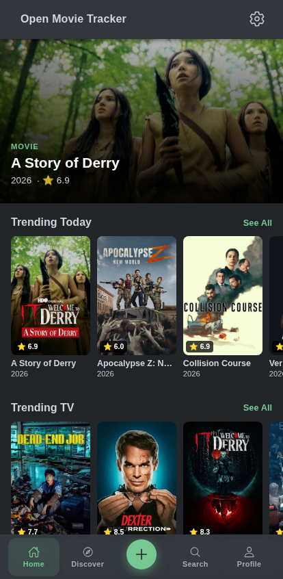
  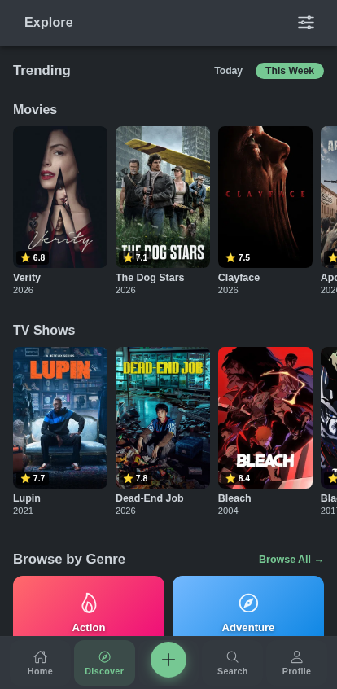
  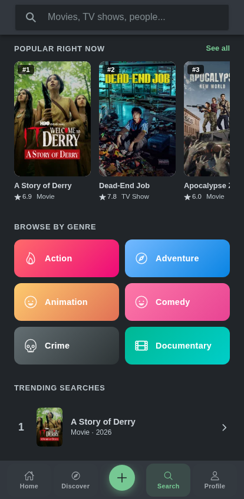
  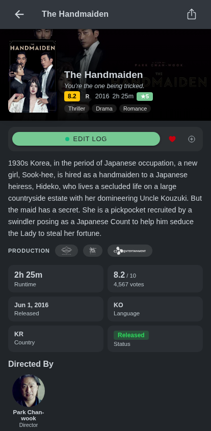
  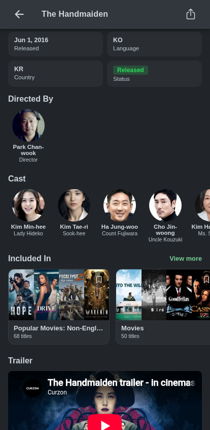
</p>
<p align="center">
  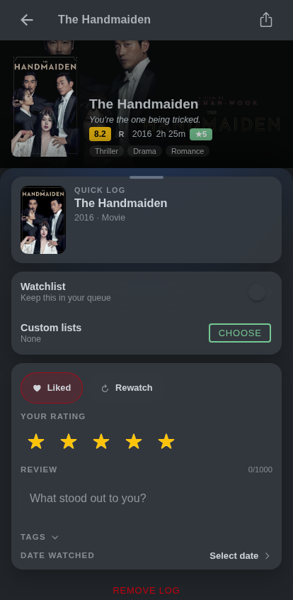
  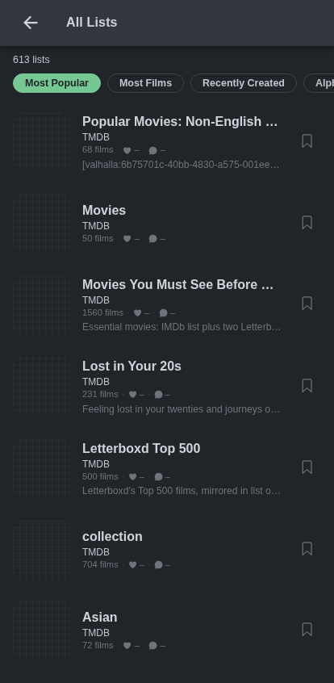
  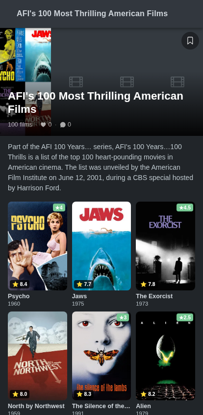
  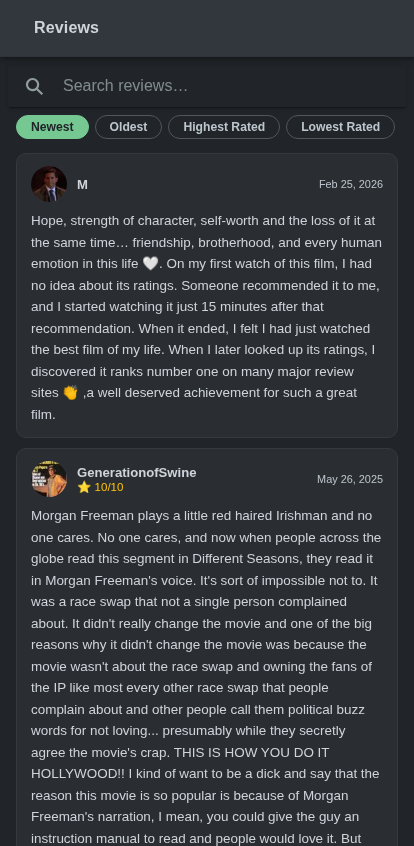
  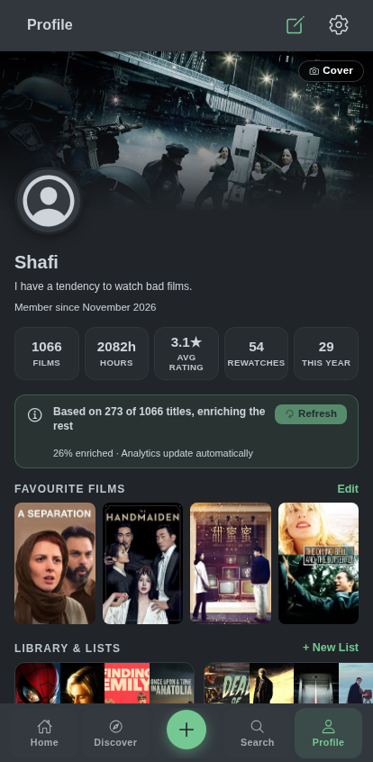
</p>
<p align="center">
  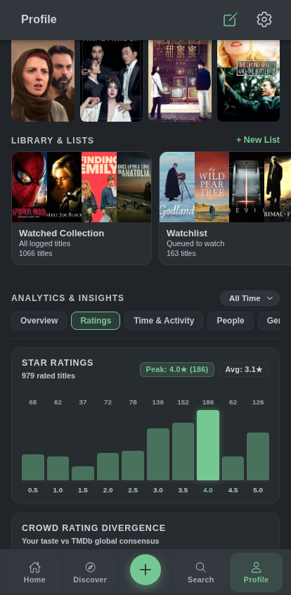
</p>

---

## Features

- **Movies & TV Tracking**: Full support for both movies and TV shows, including season and episode-level tracking with one-tap completion.
- **Letterboxd Import & Sync**: Seamlessly import your complete Letterboxd export zip (watched history, diary logs, star ratings, reviews, tags, watchlist, and custom lists).
- **Privacy First & Local Storage**: No accounts, tracking, or telemetry. All data is persisted on-device in `localStorage` with full JSON backup export and import.
- **Comprehensive Logging**: Rate on a 0.5–5.0 star scale, log watch dates, mark rewatches, write personal reviews, add tags, and like titles.
- **Discovery & Search**: Browse trending titles, explore by genre, year, or rating, search across movies, TV, and people, and explore TMDb community lists.
- **Insights & Analytics**: In-depth profile stats dashboard featuring rating distribution histograms, watch velocity, crowd rating divergence, and diary activity heatmaps.
- **Personalization**: Dark and light themes, primary color accents (green/red), language and adult-content filters, and customizable profile avatars and covers.
- **Automatic Update Checking**: Built-in release check on startup notifies you whenever a new version is available on GitHub.

---

## Tech Stack

| Layer | Technologies |
|---|---|
| **Framework** | Ionic 8 + Angular 21 |
| **Native Runtime** | Capacitor 8 |
| **Language & Styling** | TypeScript 5.9, Tailwind CSS, SCSS |
| **Data Provider** | [The Movie Database (TMDb)](https://www.themoviedb.org/) API v3 |
| **Storage** | Local-first on-device storage (`localStorage`) |
| **Testing** | Playwright (E2E), Karma / Jasmine (Unit) |

---

## Getting Started

### Prerequisites

- **Node.js** (LTS 18+)
- **pnpm** (or npm)
- **Android Studio & JDK 17+** (for Android builds)
- A free [TMDb API Key](https://www.themoviedb.org/settings/api)

### Installation & Development

```bash
# Clone the repository
git clone https://github.com/r-shafi/open-movie-tracker.git
cd open-movie-tracker

# Install dependencies
pnpm install

# Start local development server (runs at http://localhost:8100)
npm run start
```

### TMDb API Key Configuration

The app includes a fallback demo key, but you can configure your own in `src/environments/environment.ts` and `src/environments/environment.prod.ts`:

```typescript
export const environment = {
  production: false,
  tmdbApiKey: 'YOUR_TMDB_API_KEY',
  tmdbBaseUrl: 'https://api.themoviedb.org/3',
  tmdbImageBase: 'https://image.tmdb.org/t/p',
};
```

You can also update or reset your API key anytime in the in-app **Settings** menu.

### Build Android APK

```bash
npm run build
npx cap sync android
npx cap open android
```

---

## Distribution

- **GitHub Releases**: Download pre-built, signed APKs from [Releases](https://github.com/r-shafi/open-movie-tracker/releases).
- **F-Droid / IzzyOnDroid**: Submitted and pending listing on [IzzyOnDroid](https://apt.izzysoft.de/fdroid/) and [F-Droid](https://f-droid.org/).

---

## Contributing

Contributions are welcome! Please follow [Conventional Commits](https://www.conventionalcommits.org/) (`fix:`, `feat:`, `chore:`, etc.) for pull requests to maintain automated versioning and changelogs.

---

## License

Distributed under the [MIT License](LICENSE).

<p align="center">
  <sub>Data provided by <a href="https://www.themoviedb.org/">The Movie Database (TMDb)</a>. This product uses the TMDb API but is not endorsed or certified by TMDb. Open Movie Tracker is not affiliated with Letterboxd Limited.</sub>
</p>
