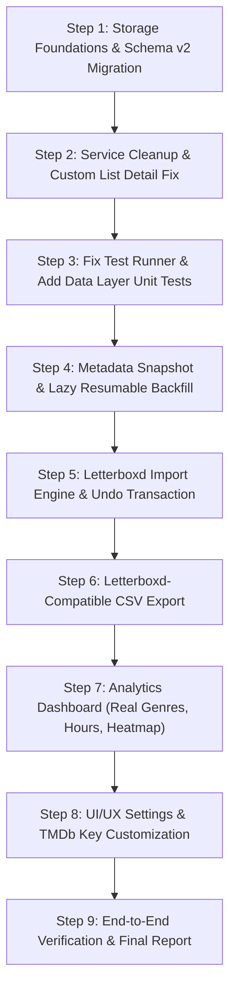

# Phase 3: Product, UX, and Analytics Enhancement Roadmap

Date: 2026-10-20
Target repository: `/home/usign/.temp/open-movie-tracker`
Guiding Principle: **100% Local-First, Privacy-First, Zero Backend, Zero Telemetry.**

---

## 1. Product Benchmarking Matrix

| Feature | Open Movie Tracker (Current) | Letterboxd (Free / Pro) | Trakt | Serializd / TV Time | Target Architecture (OMT Enhanced) |
|---|---|---|---|---|---|
| **Privacy / Account** | ✅ No account, local only | ❌ Cloud account, tracking | ❌ Cloud account, tracking | ❌ Cloud account, tracking | ✅ No account, 100% on-device data |
| **Movie Tracking** | ⚠️ Single entry per film, no rewatch history | ✅ Unlimited dated logs & rewatches | ✅ Full watch history | ❌ Movies secondary | ✅ Multi-entry diary with rewatch logs & date-unknown |
| **TV Show Tracking** | ⚠️ Episode booleans only | ❌ Films only | ✅ Complete episode history | ✅ Season & episode progress | ✅ Integrated Movie + TV episode tracker |
| **Custom Lists** | ⚠️ Broken (404 on view) | ✅ Ranked, notes, tags | ✅ Custom lists | ✅ Custom lists | ✅ Functional local lists with notes & ranking |
| **Pro Analytics** | ❌ Hardcoded 1.8h, tags as genres | 🔒 Paywalled ($19/yr) | 🔒 Paywalled VIP ($30/yr) | ⚠️ Basic stats | ✅ Full "Letterboxd Pro" analytics on-device |
| **Import / Export** | ⚠️ Unvalidated JSON replace | ⚠️ CSV export, CSV import (Pro) | ⚠️ CSV / API | ⚠️ Limited | ✅ Letterboxd ZIP & CSV import + JSON backup + CSV export |
| **Offline Usability** | ⚠️ Stale titles fail, remote logo | ❌ Requires internet | ❌ Requires internet | ❌ Requires internet | ✅ Full offline browsing of logged titles & metadata |

---

## 2. Analytics Architecture ("Letterboxd Pro-Like" Layer)

### 2.1 The Log-Time Metadata Snapshot
To compute rich analytics completely offline without repeatedly polling TMDb, each logged entry must capture a compact metadata snapshot at log time.

```typescript
export interface MediaMetadataSnapshot {
  runtimeMinutes: number;           // e.g. 142
  genres: Array<{ id: number; name: string }>; // e.g. [{ id: 18, name: "Drama" }]
  releaseYear: number;              // e.g. 1994
  releaseDate?: string;             // "1994-09-23"
  originalLanguage: string;         // e.g. "en"
  productionCountries: string[];    // e.g. ["US"]
  directors: Array<{ id: number; name: string }>; // e.g. [{ id: 4027, name: "Frank Darabont" }]
  topCast: Array<{ id: number; name: string }>;   // top 5 billed actors
  tmdbVoteAverage: number;          // e.g. 8.7
  posterPath: string | null;        // "/9cqNxx0GxF0bflZmeSMuL5tnGzr.jpg"
  backdropPath?: string | null;     // optional
}
```

### 2.2 Resumable Lazy Backfill
For entries that exist prior to migration or are imported in bulk from Letterboxd:
1. Entries are imported immediately with core data (title, year, rating, date, review).
2. A background backfill queue processes missing snapshots in small batches (e.g. 5 titles every 3 seconds) when online.
3. The queue stores its progress in local storage, yields to the UI thread, pauses immediately if the network disconnects, and resumes seamlessly on reboot.

### 2.3 Local Metrics & Calculations
All metrics are pure functions taking `WatchedEntry[]` and returning computed stat models:
1. **Year in Review & Time Windows**: Selectable filters (`All Time`, `This Year`, `Last Year`, or custom year).
2. **Activity Heatmap & Streaks**: GitHub-style 52-week activity grid plotting watch count per day, calculating current streak and longest streak.
3. **Decade & Year Distribution**: Bar chart by decade (1920s to 2020s) and release year.
4. **Real Genre Distribution**: Donut / bar chart using real TMDb genres, not user tags.
5. **Cast & Crew Insights**: Top 10 most-watched directors and actors, with average rating given (minimum sample threshold = 3 films).
6. **Rating Analysis**:
   - 10-bucket rating distribution (0.5 to 5.0 stars).
   - "Rate higher / lower than TMDb" delta comparison (identifying user's most generous vs most critical picks).
7. **Time Watched**: Exact total minutes and hours computed from real snapshot runtimes.
8. **Rewatch Ratio**: First-time watches vs rewatches count and percentage.
9. **Shareable Stats Card**: HTML5 Canvas rendering of a summary card (top 4 films, total watched, hours, top genre) generated entirely in-memory with a "Save Image" option, zero server upload.

---

## 3. Letterboxd Import & Interoperability Specification (P0 Build-Now)

### 3.1 Input Formats & Limits
- **Zip Archive**: Accept official Letterboxd `.zip` export directly using `fflate` (lightweight, zero-dependency, ~8 kB gzipped).
- **Extracted Files**: Accept individual or multi-selected `.csv` files (`diary.csv`, `ratings.csv`, `reviews.csv`, `watched.csv`, `watchlist.csv`, `likes/films.csv`, `lists/*.csv`, `profile.csv`).
- **Zip Bomb Protection**:
  - Max archive size: 50 MB
  - Max total uncompressed bytes: 100 MB
  - Max entries in archive: 500 files
  - Reject entry paths with directory traversal (`../`).
  - Read files entirely in-memory; never write temporary files to disk.

### 3.2 Robust CSV Parsing Engine
A pure TypeScript RFC 4180-compliant CSV parser:
- Handles multi-line quoted fields (critical for reviews and list descriptions containing newlines).
- Handles escaped quotes (`""`), commas inside quotes, UTF-8 BOM (`\uFEFF`), and CRLF / LF line endings.
- Dynamic header resolution (column order independent, case-insensitive).
- Strips formula injection prefixes (`=`, `+`, `-`, `@`, `\t`, `\r`) from fields when parsing/exporting.

### 3.3 File Mapping Strategy
1. **`diary.csv`** (`Date,Name,Year,Letterboxd URI,Rating,Rewatch,Tags,Watched Date`):
   - Each row maps to a distinct `WatchedEntry`.
   - `watchedAt`: uses `Watched Date`. If empty, uses `Date` marked as approximate.
   - `rating`: converted from 0.5–5.0 scale.
   - `rewatch`: boolean (`Yes` / `true`).
   - `tags`: comma-split and trimmed.
   - `sourceKey`: `Letterboxd URI`.
2. **`reviews.csv`** (`Date,Name,Year,Letterboxd URI,Rating,Rewatch,Review,Tags,Watched Date`):
   - Matched against existing diary entry by `Letterboxd URI` + `Watched Date`.
   - If no matching diary entry exists, creates a new entry with review text.
   - Caps review text at 20,000 characters and strips any HTML.
3. **`ratings.csv`** (`Date,Name,Year,Letterboxd URI,Rating`):
   - Fills rating for titles not present in diary.
   - Diary entry ratings take precedence.
4. **`watched.csv`** (`Date,Name,Year,Letterboxd URI`):
   - Films marked watched without a diary entry are imported with `dateUnknown: true`.
   - `watchedAt` is set to `null` (never fabricated).
5. **`watchlist.csv`** (`Date,Name,Year,Letterboxd URI`):
   - Added to `mva_watchlist`. If already in watched history, flagged with user choice or kept on watchlist per app preference.
6. **`likes/films.csv`** (`Date,Name,Year,Letterboxd URI`):
   - Flags `liked: true` on matching diary/watched entry. If no watched entry exists, added as watched with `dateUnknown: true` and `liked: true`.
7. **`lists/<slug>.csv`**:
   - Parses multi-table structure (v7 header line + list metadata table + items table).
   - Creates a custom local list preserving ranked order and item descriptions.
8. **`profile.csv`**:
   - Opt-in checkbox (default OFF).
   - Reads ONLY `Username` or `Given Name` -> `displayName`, and `Bio` -> `bio`.
   - **STRICT PRIVACY GUARANTEE: `Email Address`, `Family Name`, `Pronoun`, `Location`, and `Website` are NEVER parsed, stored, or logged.**
   - `Favorite Films` boxd.it URIs are resolved locally using the URI-to-title map built from other CSV files.

### 3.4 TMDb Matching Engine
- Clean normalization: diacritics removal, punctuation stripping, case folding, leading article handling ("The", "A", "An", "Le", "La", "El").
- Search cascade:
  1. `searchMovies(query, year)` (exact title + exact year).
  2. `searchMovies(query, year +/- 1)` (international festival vs theatrical release variance).
  3. Strict normalized title search.
- Matching confidence categorization:
  - **Confident Match** (Score >= 90): Auto-accepted.
  - **Ambiguous Match** (Score 60–89 or multiple top candidates within 5 points): Queued for user review.
  - **Unmatched** (No results or Score < 60): Exportable CSV report.
- Concurrency & Rate Limiting:
  - Maximum 3 concurrent requests.
  - Exponential backoff with jitter on HTTP 429.
  - Persistent matching cache in storage: restarting the app resumes from the last matched item without re-fetching.

### 3.5 Atomic Transaction & Rollback
1. Before committing changes, a complete pre-import backup snapshot is saved to `mva_import_backup`.
2. The user is shown a dry-run preview: new entries, duplicate skips, conflicts.
3. On user confirmation, new entries are written atomically.
4. A prominent banner allows one-tap "Undo Import" to restore the exact pre-import state.

---

## 4. Prioritized Feature Backlog & Scope

### 4.1 Prioritization Matrix

| Feature | Value | Effort | Risk | Data Model Impact | Priority | Target Scope |
|---|---|---|---|---|---|---|
| **Storage Durability & Migration Layer** (v2 schema, guarded writes, migrations) | Very High | M | Med | Schema v2, migration from v1 | **P0** | **Build Now** |
| **Fix Custom List Detail Crash (Q-01)** (view/manage local lists) | Critical | S | Low | None | **P0** | **Build Now** |
| **Letterboxd ZIP & Multi-CSV Import** (full specification) | Very High | L | Med | Add `sourceKey`, `dateUnknown`, multi-entry | **P0** | **Build Now** |
| **Rewatch & Multi-Entry Diary Support** (multiple logs per title) | Very High | M | Med | Diary entries keyed by unique entry ID | **P0** | **Build Now** |
| **Metadata Snapshot & Resumable Backfill** | High | M | Low | Snapshot object on entries | **P0** | **Build Now** |
| **Letterboxd Pro-Style Analytics Dashboard** (stats, real genres, heatmap) | High | M | Low | Uses snapshots | **P0** | **Build Now** |
| **User TMDb API Key Option in Settings** | High | S | Low | Added to `mva_settings` | **P0** | **Build Now** |
| **Clean Dead Code** (remove `ProfileService`, `SettingsService`, `movies/`) | Med | S | Low | Code cleanup | **P0** | **Build Now** |
| **Fix Test Harness & Core Data Layer Tests** | High | M | Low | `test.ts` fixed, unit specs | **P0** | **Build Now** |
| **Letterboxd-Compatible CSV Export** (diary, ratings, watchlist) | High | S | Low | None | **P0** | **Build Now** |
| **Tablet & Desktop Responsive Layout** (centered max-w container) | Med | S | Low | CSS / SCSS | **P1** | Next Iteration |
| **Virtual Scrolling for 5,000+ Items** | High | M | Med | UI rendering | **P1** | Next Iteration |
| **Offline Stale Title Fallback** | Med | S | Low | UI fallback | **P1** | Next Iteration |
| **Android Back Button Priority Handling** | Med | S | Low | Ionic backButton | **P1** | Next Iteration |

---

## 5. Deliberately NOT Building (Out of Scope)

1. **User Accounts / Cloud Synchronization**:
   - *Reason*: Violates core product guarantee ("Privacy is the product, local-only, no telemetry, no account").
2. **Third-Party Social Feeds / Following**:
   - *Reason*: Requires a central backend database and exposes user viewing habits.
3. **Scraping Letterboxd Web Pages Directly**:
   - *Reason*: Fragile, violates Letterboxd ToS, and creates network leaks. Only official user-supplied export files are accepted.
4. **Third-Party Analytics / Crash Reporting (Firebase, Sentry, GA)**:
   - *Reason*: Strictly forbidden by privacy policy.

---

## 6. Implementation Sequence ("Build Now" Plan)



### Step 1: Storage Foundations & Schema v2 Migration
- Create `StorageService` with guarded writes, quota checking, and quota recovery.
- Migrate `mva_watched` from single `${mediaType}:${id}` map to support multiple dated entries per title (diary records), stable `id: string` (UUID) per entry, optional `sourceKey`, and `dateUnknown: boolean`.
- Store schema version `mva_schema_version = 2`.

### Step 2: Service Cleanup & Custom List Detail Fix
- Remove dead `ProfileService` (`profile.service.ts`), dead `SettingsService` (`settings.service.ts`), dead `movies/` directory, and `tslint.json`.
- Fix `ListDetailPage` so it checks local `UserDataService.getList(id)` before attempting to query TMDb, allowing users to view and delete items in their custom lists.

### Step 3: Fix Test Runner & Unit Tests
- Update `/home/usign/.temp/open-movie-tracker/src/test.ts` to import `zone.js/testing`.
- Add unit tests for `UserDataService`, schema migrations, rating clamps, and list management.

### Step 4: Metadata Snapshot & Lazy Resumable Backfill
- Extend log sheet and logging flow to store `MediaMetadataSnapshot` (runtime, real genres, director, year, poster) at log time.
- Build resumable background backfill queue for unpopulated snapshots.

### Step 5: Letterboxd Import Engine & Undo Transaction
- Implement pure CSV parser with multi-line, BOM, and CRLF support.
- Implement zip archive reader using `fflate`.
- Implement TMDb fuzzy matching with scoring and 429 backoff.
- Build import wizard in Settings (File detection -> Options -> Matching progress -> Review ambiguous -> Atomic commit -> Undo).

### Step 6: Letterboxd-Compatible CSV Export
- Export user diary and watchlist in standard Letterboxd CSV format with formula injection sanitization.

### Step 7: Analytics Dashboard
- Rewrite `UserDataService.getStats()` into pure calculation functions.
- Update Profile stats tab to display real genre distribution, exact runtime hours, rating curve, and monthly momentum.

### Step 8: Settings Enhancements & Verification
- Add custom TMDb API key input with reset-to-default fallback in Settings.
- Add bundled SVG for TMDb logo to ensure offline compliance.
- Run full test suite, lint, production build, and end-to-end import verification.

---

**Gate status:** Roadmap and enhancement design complete. Ready for implementation approval.
