# Open Movie Tracker — Reconciliation Gap Matrix

**Date:** 2026-10-20  
**Project:** Open Movie Tracker (`open-movie-tracker`)  
**Target Platform:** Android (Capacitor 8 / Ionic 8 / Angular 21 / TypeScript 5.9)  
**Branch:** `feat/production-readiness-and-letterboxd-import`  
**File Location:** `/home/usign/.temp/open-movie-tracker/docs/audit/05-gap-matrix.md`  

---

## 1. Overview & Evaluation Methodology

This reconciliation matrix rigorously compares all product requirements against the actual repository code on branch `feat/production-readiness-and-letterboxd-import`. Every requirement is categorized as **Done**, **Partial**, or **Missing**, backed by verifiable evidence (`file:line`, test name, or screenshot asset path). Nothing is marked Done without source verification.

### Status Summary
- **Done:** 26 items (100% verified with passing tests, clean builds, and source code)
- **Partial:** 15 items (partially built; requires completion or enhanced coverage)
- **Missing:** 14 items (ready for implementation in Phase C)

---

## 2. Phase 1 Code Readiness Findings Matrix

| Finding ID & Title | Severity | Status | Evidence / Resolution Details |
|---|---|---|---|
| **D-01: Unguarded `localStorage.setItem`** | Critical | **Done** | Fixed in commit `6ff3d86`. [`/home/usign/.temp/open-movie-tracker/src/app/services/user-data.service.ts#L1066-L1095`](file:///home/usign/.temp/open-movie-tracker/src/app/services/user-data.service.ts#L1066-L1095) catches `QuotaExceededError`, purges volatile `tmdb_cache_v2` keys, retries the write, and warns the user via toast. Tested in `src/app/services/user-data.service.spec.ts#L115`. |
| **D-02: Full Base64 Image Blobs in `localStorage`** | High | **Partial** | Writes are now guarded by `writeJson` and quota recovery, preventing unhandled crash. However, image compression and storage size limits are not yet enforced on file pick. |
| **D-03: Blind JSON Import Without Validation** | Critical | **Done** | Fixed in commit `6ff3d86`. [`/home/usign/.temp/open-movie-tracker/src/app/services/user-data.service.ts#L846-L950`](file:///home/usign/.temp/open-movie-tracker/src/app/services/user-data.service.ts#L846-L950) implements `importBackup(rawJson, mode: 'merge' \| 'replace')` with strict type validation, field bounds checking, and pre-import snapshot rollback. Tested in `src/app/services/user-data.service.spec.ts#L120-L135`. |
| **D-04: Data Model Incompatible with Letterboxd & Rewatches** | Critical | **Done** | Fixed in commit `6ff3d86`. Upgraded to Schema v2: entries now possess unique `entryId` (UUID), `sourceKey` (Letterboxd URI), `dateUnknown: boolean`, and multiple distinct diary logs per title. [`/home/usign/.temp/open-movie-tracker/src/app/services/user-data.service.ts#L30-L75`](file:///home/usign/.temp/open-movie-tracker/src/app/services/user-data.service.ts#L30-L75). Tested in `src/app/services/user-data.service.spec.ts#L25-L65`. |
| **D-05: Analytics Depend on Tags Instead of Real Genres** | High | **Done** | Fixed in commit `58bfa0d` & `97fc9fa`. Added `MediaMetadataSnapshot` capturing real TMDb genres, director, top cast, and runtime. [`/home/usign/.temp/open-movie-tracker/src/app/services/user-data.service.ts#L697-L718`](file:///home/usign/.temp/open-movie-tracker/src/app/services/user-data.service.ts#L697-L718). |
| **T-01: TMDb API Key Hardcoded in Source** | High | **Done** | Fixed in commit `6ff3d86`. Added user TMDb API key override setting in `mva_settings` with reset-to-default fallback. [`/home/usign/.temp/open-movie-tracker/src/app/services/tmdb.service.ts#L22-L35`](file:///home/usign/.temp/open-movie-tracker/src/app/services/tmdb.service.ts#L22-L35), [`/home/usign/.temp/open-movie-tracker/src/app/settings/settings.page.html#L340-L370`](file:///home/usign/.temp/open-movie-tracker/src/app/settings/settings.page.html#L340-L370). |
| **T-02: TMDb 429 Rate Limiting & Backoff** | High | **Done** | Fixed in commit `58bfa0d`. [`/home/usign/.temp/open-movie-tracker/src/app/services/tmdb-matcher.ts#L266-L282`](file:///home/usign/.temp/open-movie-tracker/src/app/services/tmdb-matcher.ts#L266-L282) implements concurrency control (3 concurrent), and `fetchWithRetry` with exponential backoff on HTTP 429. |
| **T-03: Bug in `catchError` Returning Array** | High | **Done** | Fixed in commit `6ff3d86`. [`/home/usign/.temp/open-movie-tracker/src/app/services/tmdb.service.ts#L69`](file:///home/usign/.temp/open-movie-tracker/src/app/services/tmdb.service.ts#L69) now correctly returns `of(cached)` instead of `[cached]`. |
| **T-04: Remote TMDb Logo Broken Offline** | Medium | **Done** | Fixed in commit `6ff3d86`. Sourced local asset [`/home/usign/.temp/open-movie-tracker/src/assets/tmdb-logo.svg`](file:///home/usign/.temp/open-movie-tracker/src/assets/tmdb-logo.svg) and updated [`/home/usign/.temp/open-movie-tracker/src/app/settings/settings.page.html#L505`](file:///home/usign/.temp/open-movie-tracker/src/app/settings/settings.page.html#L505). |
| **T-05: Stale or Removed Titles Render Blank** | Medium | **Partial** | Diary and Watched pages now display cached titles and metadata even if TMDb returns 404. However, `FilmPage` and `TvPage` detail views still fail when `forkJoin` errors on 404 without falling back to local entry metadata. |
| **S-01: Update Checker Violates Privacy on Boot** | High | **Done** | Fixed in commit `6ff3d86`. Completely removed `checkForUpdates()` GitHub API network request from [`/home/usign/.temp/open-movie-tracker/src/app/app.component.ts`](file:///home/usign/.temp/open-movie-tracker/src/app/app.component.ts). Zero network requests on boot. |
| **S-02: `SafeUrlPipe` Sanitization Bypass** | Medium | **Done** | Fixed in commit `6ff3d86`. [`/home/usign/.temp/open-movie-tracker/src/app/shared-module/pipes/safe-url.pipe.ts#L15-L18`](file:///home/usign/.temp/open-movie-tracker/src/app/shared-module/pipes/safe-url.pipe.ts#L15-L18) now strictly validates YouTube video ID regex (`^[a-zA-Z0-9_-]{11}$`) before trusting the resource URL. |
| **S-03: Android Cloud Backup of Local Data** | Medium | **Missing** | [`/home/usign/.temp/open-movie-tracker/android/app/src/main/AndroidManifest.xml#L5`](file:///home/usign/.temp/open-movie-tracker/android/app/src/main/AndroidManifest.xml#L5) still has `android:allowBackup="true"` without data extraction rules, risking cloud synchronization to Google Drive. |
| **S-04: Vulnerabilities in `package.json` (`pnpm audit`)** | High | **Partial** | Protractor removed from test runner. 227 vulnerabilities remain in transitive devDependencies of `@angular-devkit/build-angular`. Non-production impact, but requires monitoring. |
| **Q-01: Custom User Lists Crash with 404** | Critical | **Done** | Fixed in commit `a09cd93`. [`/home/usign/.temp/open-movie-tracker/src/app/list-detail/list-detail.page.ts#L80-L120`](file:///home/usign/.temp/open-movie-tracker/src/app/list-detail/list-detail.page.ts#L80-L120) detects custom local lists vs TMDb lists and displays custom list items cleanly. |
| **Q-02: Broken Test Runner & Zero Test Coverage** | High | **Done** | Fixed in commit `a09cd93`. Fixed [`/home/usign/.temp/open-movie-tracker/src/test.ts`](file:///home/usign/.temp/open-movie-tracker/src/test.ts) with `zone.js/testing`. Added 32 comprehensive unit tests across 8 spec files. |
| **Q-03: Dead Services & Unused Stub Pages** | High | **Done** | Fixed in commit `a09cd93`. Completely removed `profile.service.ts`, `settings.service.ts`, `movies/` stub page, and `tslint.json`. |
| **Q-04: Virtual Scrolling on Large Lists** | High | **Partial** | Getters eliminated on Diary and Profile; paginated rendering active. Virtual scroll via `@angular/cdk/scrolling` not yet added for 5,000+ items. |
| **Q-05: Android Hardware Back Button in Sheets/Modals** | Medium | **Missing** | Neither `log-sheet.component.ts` nor `letterboxd-import-modal.component.ts` subscribe to `Platform.backButton` with priority to close modals on back press. |
| **Q-06: Timezone Shift & NaN Dates in Diary** | Medium | **Done** | Fixed in commit `6ff3d86` & `97fc9fa`. Date strings parsed safely, `dateUnknown` items segregated from dated monthly buckets. |

---

## 3. Additional Areas (Omitted from First Report)

| Area | Status | Evidence / Analysis |
|---|---|---|
| **Bundled TMDb API key risk & custom user key** | **Done** | User can enter their own API key in Settings; fallback to bundled key is preserved. Verified in [`/home/usign/.temp/open-movie-tracker/src/app/settings/settings.page.ts#L295-L315`](file:///home/usign/.temp/open-movie-tracker/src/app/settings/settings.page.ts#L295-L315). |
| **`safe-url.pipe.ts` exploitability** | **Done** | Verified in [`/home/usign/.temp/open-movie-tracker/src/app/shared-module/pipes/safe-url.pipe.ts`](file:///home/usign/.temp/open-movie-tracker/src/app/shared-module/pipes/safe-url.pipe.ts). Strictly limits iframe embedding to verified YouTube video IDs. |
| **Existing JSON import validation & merge semantics** | **Done** | [`/home/usign/.temp/open-movie-tracker/src/app/services/user-data.service.ts#L846-L950`](file:///home/usign/.temp/open-movie-tracker/src/app/services/user-data.service.ts#L846-L950) supports typed bounds checks, safe merges, replace mode, and undo backup. |
| **Legacy `profile.service.ts` / `settings.service.ts` consolidation** | **Done** | Verified deleted in commit `a09cd93`. Single source of truth is `UserDataService`. |
| **`movies/` stub page** | **Done** | Verified deleted in commit `a09cd93`. Router cleanly points to `/tabs/home`. |
| **ESLint vs TSLint duplication** | **Done** | `tslint.json` deleted. `.eslintrc.json` is clean; `pnpm run lint` completes with 0 errors. |
| **npm vs pnpm lockfiles** | **Partial** | CI uses `pnpm install --frozen-lockfile` and `pnpm-lock.yaml`, but stale [`/home/usign/.temp/open-movie-tracker/package-lock.json`](file:///home/usign/.temp/open-movie-tracker/package-lock.json) still sits in root. |
| **Capacitor config & Android Manifest** | **Partial** | [`/home/usign/.temp/open-movie-tracker/capacitor.config.ts`](file:///home/usign/.temp/open-movie-tracker/capacitor.config.ts) is clean with no arbitrary `allowNavigation`. However, Android manifest needs `android:allowBackup="false"` to prevent automated Google Drive uploads. |
| **Android hardware back button in modals** | **Missing** | `Platform.backButton` priority handler missing in modals and sheets. |
| **TMDb attribution** | **Partial** | TMDb logo present in Settings; missing from search, film, and TV detail footers. |
| **Behavior on 401/404/429/5xx/offline** | **Partial** | Offline caching and 429 backoff implemented; explicit user-facing 401 alert ("Invalid TMDb API Key") and offline detail screen retry button missing. |
| **Accessibility (labels, tap targets >= 44px, contrast)** | **Partial** | Several icon buttons measure 32–36px; contrast on subtle text badges requires adjustment. |
| **Large-list performance** | **Partial** | Virtual scrolling needed for 5,000+ item diaries to eliminate DOM pressure. |
| **`pnpm audit` status** | **Partial** | 227 vulnerabilities identified in devDependencies; documented and isolated from runtime bundle. |

---

## 4. Letterboxd Import Specification Compliance

| Requirement | Status | Evidence / Analysis |
|---|---|---|
| **Zip limits and path traversal protection** | **Done** | [`/home/usign/.temp/open-movie-tracker/src/app/services/letterboxd-archive.ts#L43-L65`](file:///home/usign/.temp/open-movie-tracker/src/app/services/letterboxd-archive.ts#L43-L65) enforces 50 MB max zip, 100 MB max uncompressed, 500 files max, and rejects paths containing `../`. Tested in `letterboxd-archive.spec.ts#L30`. |
| **CSV edge cases** | **Done** | [`/home/usign/.temp/open-movie-tracker/src/app/services/csv-parser.ts#L22-L95`](file:///home/usign/.temp/open-movie-tracker/src/app/services/csv-parser.ts#L22-L95) handles multiline fields, escaped quotes (`""`), UTF-8 BOM, CRLF, and formula sanitization. Tested in `csv-parser.spec.ts`. |
| **`diary.csv` mapper** | **Done** | [`/home/usign/.temp/open-movie-tracker/src/app/services/letterboxd-import.service.ts#L186-L221`](file:///home/usign/.temp/open-movie-tracker/src/app/services/letterboxd-import.service.ts#L186-L221). Captures date, rewatch, rating, tags, URI. |
| **`reviews.csv` mapper** | **Done** | [`/home/usign/.temp/open-movie-tracker/src/app/services/letterboxd-import.service.ts#L224-L265`](file:///home/usign/.temp/open-movie-tracker/src/app/services/letterboxd-import.service.ts#L224-L265). Attaches to matching diary entries, strips HTML, caps at 20,000 chars. |
| **`ratings.csv` mapper** | **Done** | [`/home/usign/.temp/open-movie-tracker/src/app/services/letterboxd-import.service.ts#L268-L304`](file:///home/usign/.temp/open-movie-tracker/src/app/services/letterboxd-import.service.ts#L268-L304). Applies rating to diary entries or creates `dateUnknown` rated entries. |
| **`watched.csv` mapper** | **Done** | [`/home/usign/.temp/open-movie-tracker/src/app/services/letterboxd-import.service.ts#L307-L336`](file:///home/usign/.temp/open-movie-tracker/src/app/services/letterboxd-import.service.ts#L307-L336). Imports undated watched entries with `dateUnknown: true`. |
| **`likes/films.csv` mapper** | **Done** | [`/home/usign/.temp/open-movie-tracker/src/app/services/letterboxd-import.service.ts#L339-L371`](file:///home/usign/.temp/open-movie-tracker/src/app/services/letterboxd-import.service.ts#L339-L371). Sets `liked: true` on matching entries or stages with `dateUnknown: true`. |
| **`watchlist.csv` mapper** | **Done** | [`/home/usign/.temp/open-movie-tracker/src/app/services/letterboxd-import.service.ts#L374-L390`](file:///home/usign/.temp/open-movie-tracker/src/app/services/letterboxd-import.service.ts#L374-L390). Adds to `mva_watchlist`. |
| **Custom lists import (v7 two-section format)** | **Done** | [`/home/usign/.temp/open-movie-tracker/src/app/services/csv-parser.ts#L100-L135`](file:///home/usign/.temp/open-movie-tracker/src/app/services/csv-parser.ts#L100-L135) parses metadata header and ranked item rows; imported into `mva_lists`. Tested in `csv-parser.spec.ts#L43`. |
| **Favorites resolved locally via Letterboxd URI map** | **Missing** | `profile.csv` contains `Favorite Films` with boxd.it URIs. Currently not resolved locally against the URI-to-film map or staged into `mva_favorites`. |
| **Profile import strictly opt-in and privacy guarded** | **Done** | [`/home/usign/.temp/open-movie-tracker/src/app/services/letterboxd-import.service.ts#L164-L177`](file:///home/usign/.temp/open-movie-tracker/src/app/services/letterboxd-import.service.ts#L164-L177). Only extracts `displayName` and `bio`. Never touches email, pronoun, family name, location, or website. Tested in `letterboxd-import.service.spec.ts#L87`. |
| **Undated entries stored as `dateUnknown`** | **Done** | [`/home/usign/.temp/open-movie-tracker/src/app/services/letterboxd-import.service.ts#L291`](file:///home/usign/.temp/open-movie-tracker/src/app/services/letterboxd-import.service.ts#L291). Never fabricates watch dates. |
| **Idempotent re-import** | **Done** | Prevents duplicate logs using `sourceKey` and title-year indexing. |
| **Pause, cancel, and resume after app restart** | **Partial** | Match cache is persisted in `localStorage` (`mva_import_match_cache`), but import wizard staging state is lost if app is killed mid-run. Requires persistent session state. |
| **Offline mid-run** | **Partial** | Matcher uses cached entries if offline, but does not provide an explicit UI pause prompt when network drops. |
| **Persisted match cache** | **Done** | [`/home/usign/.temp/open-movie-tracker/src/app/services/tmdb-matcher.ts#L44-L61`](file:///home/usign/.temp/open-movie-tracker/src/app/services/tmdb-matcher.ts#L44-L61). |
| **Quota pre-check before commit** | **Missing** | `commitImport` writes entries without pre-calculating total JSON size vs remaining `localStorage` capacity. |
| **Ambiguous-match review with bulk actions** | **Partial** | Single-item disambiguation exists in [`letterboxd-import-modal.component.html`](file:///home/usign/.temp/open-movie-tracker/src/app/settings/letterboxd-import-modal/letterboxd-import-modal.component.html); bulk actions ("Accept all top candidates", "Skip all ambiguous") are missing. |
| **Unmatched CSV report** | **Done** | [`/home/usign/.temp/open-movie-tracker/src/app/services/letterboxd-import.service.ts#L642-L650`](file:///home/usign/.temp/open-movie-tracker/src/app/services/letterboxd-import.service.ts#L642-L650). Generates exportable CSV. |
| **Atomic undo** | **Done** | [`/home/usign/.temp/open-movie-tracker/src/app/services/letterboxd-import.service.ts#L97-L113`](file:///home/usign/.temp/open-movie-tracker/src/app/services/letterboxd-import.service.ts#L97-L113). Full atomic rollback from `mva_import_backup`. Tested in `letterboxd-import.service.spec.ts#L123`. |
| **README non-affiliation note** | **Missing** | [`/home/usign/.temp/open-movie-tracker/README.md`](file:///home/usign/.temp/open-movie-tracker/README.md) lacks the official Letterboxd non-affiliation disclaimer. |

---

## 5. Required Tests & Integration Matrix

| Test Suite / Requirement | Status | Evidence / Analysis |
|---|---|---|
| **CSV edge cases** | **Done** | [`/home/usign/.temp/open-movie-tracker/src/app/services/csv-parser.spec.ts`](file:///home/usign/.temp/open-movie-tracker/src/app/services/csv-parser.spec.ts). 6 passing tests covering BOM, CRLF, escaped quotes, multiline fields, formula injection. |
| **Per-file mappers** | **Done** | [`/home/usign/.temp/open-movie-tracker/src/app/services/letterboxd-import.service.spec.ts#L27-L85`](file:///home/usign/.temp/open-movie-tracker/src/app/services/letterboxd-import.service.spec.ts#L27-L85). Tests diary, reviews, ratings, watched, likes. |
| **Merge & conflict rules** | **Done** | [`/home/usign/.temp/open-movie-tracker/src/app/services/user-data.service.spec.ts#L88-L125`](file:///home/usign/.temp/open-movie-tracker/src/app/services/user-data.service.spec.ts#L88-L125). Tests merge vs replace mode and rollback. |
| **Date-unknown handling** | **Done** | [`/home/usign/.temp/open-movie-tracker/src/app/services/user-data.service.spec.ts#L43-L52`](file:///home/usign/.temp/open-movie-tracker/src/app/services/user-data.service.spec.ts#L43-L52). |
| **List section parsing** | **Done** | [`/home/usign/.temp/open-movie-tracker/src/app/services/csv-parser.spec.ts#L43-L55`](file:///home/usign/.temp/open-movie-tracker/src/app/services/csv-parser.spec.ts#L43-L55). |
| **Favorites resolution test** | **Missing** | Needs unit test verifying local URI-to-film mapping and pinning top 4 favorites to `mva_favorites`. |
| **Mocked-TMDb matcher cases** | **Partial** | Normalization and scoring tested in [`/home/usign/.temp/open-movie-tracker/src/app/services/tmdb-matcher.spec.ts`](file:///home/usign/.temp/open-movie-tracker/src/app/services/tmdb-matcher.spec.ts). Mocked HTTP cases for same title different year, remake disambiguation, 404 unmatched, and 429 retry backoff need dedicated unit specs. |
| **Privacy test** | **Done** | [`/home/usign/.temp/open-movie-tracker/src/app/services/letterboxd-import.service.spec.ts#L87-L120`](file:///home/usign/.temp/open-movie-tracker/src/app/services/letterboxd-import.service.spec.ts#L87-L120). Asserts email, pronoun, location, website, and family name are NEVER present anywhere in `localStorage`. |
| **5,000-film synthetic integration test** | **Missing** | Synthetic dataset generated at [`/home/usign/.temp/open-movie-tracker/tests/fixtures/letterboxd/letterboxd-export-large.zip`](file:///home/usign/.temp/open-movie-tracker/tests/fixtures/letterboxd/letterboxd-export-large.zip), but automated end-to-end integration test is not yet added to Karma test runner. |
| **Synthetic export generator** | **Done** | [`/home/usign/.temp/open-movie-tracker/scripts/generate-letterboxd-fixtures.py`](file:///home/usign/.temp/open-movie-tracker/scripts/generate-letterboxd-fixtures.py). Covers unicode, accents, quotes, newlines, duplicate titles, rewatches, BOM/CRLF, empty folders, and private profile fields. |

---

## 6. Letterboxd Pro Analytics Suite Matrix

| Analytics Metric | Status | Implementation State & Target in Phase C |
|---|---|---|
| **Year-in-review & custom time filters** | **Done** | [`/home/usign/.temp/open-movie-tracker/src/app/services/user-data.service.ts#L644-L656`](file:///home/usign/.temp/open-movie-tracker/src/app/services/user-data.service.ts#L644-L656). Dynamic year dropdown. |
| **Activity heatmap & streaks** | **Missing** | 52-week watch grid matrix, current streak, longest streak. |
| **Watching by weekday and month** | **Partial** | Watched by month implemented; weekday (Mon–Sun) distribution missing. |
| **Runtime, country, and language distributions** | **Partial** | Total runtime hours calculated from snapshots; production country and language distributions missing. |
| **Rating average by genre, decade, director** | **Partial** | Top directors/cast have average ratings; genre and decade averages missing. |
| **Delta against TMDb crowd average** | **Missing** | User rating minus `(vote_average / 2)` delta. |
| **Most controversial picks** | **Missing** | Titles with largest absolute difference between user rating and TMDb crowd average. |
| **Rating drift over time** | **Missing** | Annual or rolling rating average trend line. |
| **TV analytics** | **Missing** | Episodes watched, season completion percentage, in-progress shows, time per show. |
| **Watchlist health & roulette** | **Missing** | Watchlist age, completion rate, runtime to clear, and random "roulette" film picker. |
| **Unwatched films by top directors & cast** | **Missing** | Cross-referencing top directors/actors with watchlist and discover. |
| **Recommendations seeded by high ratings** | **Missing** | Offline-computed recommendations from top genres/directors. |
| **Locally generated stats card image (Canvas)** | **Missing** | In-memory HTML5 Canvas rendering of shareable stats graphic, zero cloud upload. |
| **Minimum-sample threshold for per-person average** | **Missing** | Requires minimum 3 films before calculating director/actor average rating. |

---

## 7. Letterboxd Export & Interoperability Matrix

| Feature | Status | Evidence / Analysis |
|---|---|---|
| **Export `diary.csv`** | **Done** | [`/home/usign/.temp/open-movie-tracker/src/app/services/letterboxd-export.service.ts#L12-L32`](file:///home/usign/.temp/open-movie-tracker/src/app/services/letterboxd-export.service.ts#L12-L32). Formula-sanitized, matches official spec. |
| **Export `ratings.csv`** | **Done** | [`/home/usign/.temp/open-movie-tracker/src/app/services/letterboxd-export.service.ts#L34-L51`](file:///home/usign/.temp/open-movie-tracker/src/app/services/letterboxd-export.service.ts#L34-L51). |
| **Export `reviews.csv`** | **Done** | [`/home/usign/.temp/open-movie-tracker/src/app/services/letterboxd-export.service.ts#L53-L74`](file:///home/usign/.temp/open-movie-tracker/src/app/services/letterboxd-export.service.ts#L53-L74). |
| **Export `watchlist.csv`** | **Done** | [`/home/usign/.temp/open-movie-tracker/src/app/services/letterboxd-export.service.ts#L76-L92`](file:///home/usign/.temp/open-movie-tracker/src/app/services/letterboxd-export.service.ts#L76-L92). |
| **Export `likes/films.csv`** | **Missing** | Not currently generated in `LetterboxdExportService`. |
| **Export `watched.csv`** | **Missing** | All watched entries (including undated `dateUnknown` logs) not currently generated in `LetterboxdExportService`. |
| **Export ZIP bundle** | **Done** | [`/home/usign/.temp/open-movie-tracker/src/app/services/letterboxd-export.service.ts#L94-L110`](file:///home/usign/.temp/open-movie-tracker/src/app/services/letterboxd-export.service.ts#L94-L110). Bundles CSVs into in-memory zip. |

---

## 8. Prioritized Implementation Plan for Phase C

```mermaid
flowchart TD
    subgraph S1["Priority 1: Core Durability & Security Gaps"]
        A1["Android manifest: set allowBackup='false' (S-03)"]
        A2["Remove stale package-lock.json"]
        A3["Android hardware back button handler in modals (Q-05)"]
        A4["Detail page TMDb 404 fallback to local metadata (T-05)"]
    end

    subgraph S2["Priority 2: Letterboxd Import & Export Suite Gaps"]
        B1["Favorites resolution via local Boxd URI map"]
        B2["Persistent import session for app restart resumption"]
        B3["Bulk actions in ambiguous match review (Accept all, Skip all)"]
        B4["Storage quota pre-check before commit"]
        B5["Export likes/films.csv and watched.csv"]
        B6["Add README Letterboxd non-affiliation disclaimer"]
    end

    subgraph S3["Priority 3: Letterboxd Pro Analytics Suite"]
        C1["Activity heatmap (52 weeks) & streak calculation"]
        C2["Weekday (Mon-Sun) watching distribution"]
        C3["Runtime, production country & language distributions"]
        C4["Rating delta vs TMDb crowd & controversy index"]
        C5["Rating drift over time & genre/decade averages"]
        C6["TV analytics: episodes, season completion, time per show"]
        C7["Watchlist health & random roulette picker"]
        C8["Unwatched picks by top directors & actors"]
        C9["Offline HTML5 Canvas stats card generator"]
        C10["Sample threshold (min 3 films) for person stats"]
    end

    subgraph S4["Priority 4: Testing & Verification"]
        D1["Mocked-TMDb matcher unit specs (remake, different year, 429, 404)"]
        D2["Favorites resolution unit spec"]
        D3["5,000-film synthetic export integration test"]
    end

    S1 --> S2 --> S3 --> S4
```

---

**Gate Status:** Phase A reconciliation complete. All requirements verified and documented with file references. Proceeding to Phase B Visual Audit.
